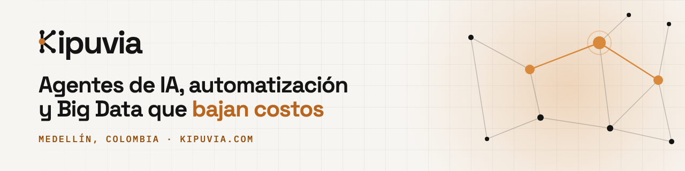

  

# Hola, soy Davinson Montoya 👋

### CEO & Arquitecto de Soluciones en [Kipuvia](https://kipuvia.com)

Ayudo a empresas en Colombia a **bajar costos y decidir más rápido** con agentes de IA, automatización de procesos, Big Data y software a la medida. Más de 15 años construyendo sistemas que siguen en producción.

---

## Resultados que he entregado

| Reto                                               | Resultado                                                                                                              |
| -------------------------------------------------- | ---------------------------------------------------------------------------------------------------------------------- |
| Factura de AWS fuera de control                    | De **USD 1.000 a USD 200 al mes** en tres facturaciones (base de datos reestructurada + migración de EC2 a serverless) |
| Recepción de 2 millones de facturas por semestre   | Agente de IA que redujo el equipo operativo **de 5 a 2 personas**                                                      |
| Fraude en decisiones financieras                   | Data lake con KPI y alertas que **redujo el fraude en un 60 %**                                                        |
| 3 sistemas legacy sostenidos por 6 desarrolladores | Modernización en 7 meses: los mismos sistemas con **2 desarrolladores**                                                |
| KPI gerenciales que tardaban 15 a 30 días          | Indicadores **en tiempo real**, integrados con contabilidad y ERP                                                      |
| Información dispersa en toda la empresa            | Centralización de **100 millones de registros** para la toma de decisiones                                             |

> Los casos se presentan sin nombre de cliente por confidencialidad.

---

## En qué te puedo ayudar

- **Agentes de IA** — compras de inventario, rutas, recepción de facturas, centros de control. Un agente mediano sale en unos 20 días.
- **Automatización de procesos** — RPA y BPM con UiPath, Power Automate y Python.
- **Big Data y analítica** — data lakes, pipelines ETL/ELT, tableros en Power BI, Looker Studio o a la medida.
- **Modernización de software legacy** — administro tu sistema actual, lo abarato y le construyo módulos e integraciones nuevas.
- **Desarrollo a la medida** — plataformas web, apps móviles y sistemas internos.

---

## Stack

**Backend:** Python (FastAPI, Django, Flask) · Go · Node.js (NestJS) · Java · .NET · PHP  
**Frontend y móvil:** Angular · React · Vue · Flutter · Kotlin · Swift  
**Nube:** AWS (Lambda, SAM, API Gateway, DynamoDB, S3, Glue, Athena) · Azure · GCP  
**Datos e IA:** Spark · Scala · SQL · Databricks · BigQuery · Bedrock · Azure OpenAI · Vertex AI · Claude · GPT · Gemini  
**Formación:** Especialización en Inteligencia Artificial, Universidad Nacional de Colombia

---

## Hablemos

Si tienes un proceso manual, un sistema que te sale caro o datos que nadie está aprovechando, cuéntame el caso.

📧 [davinson@kipuvia.com](mailto:davinson@kipuvia.com) · 🌐 [kipuvia.com](https://kipuvia.com) · 💼 [LinkedIn](https://www.linkedin.com/in/davinson-montoya-ramirez-82b136b8)
